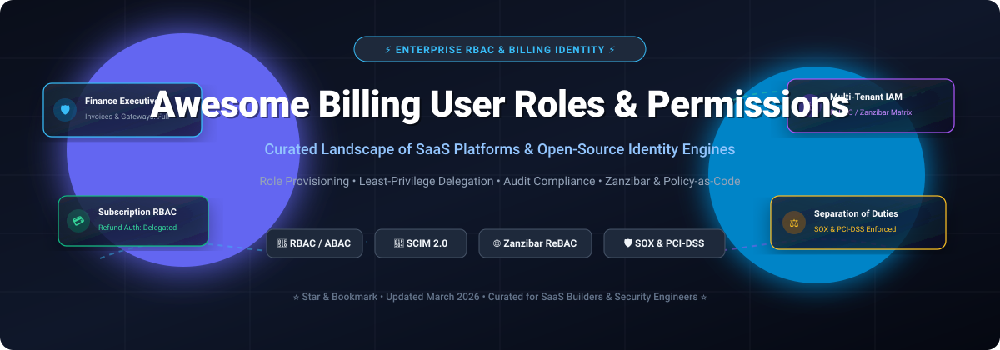

<p align="center">
  <a href="https://github.com/ishandutta2007/Awesome-Billing-User-Roles-Permissions">
    
  </a>
</p>

# Awesome Billing User Roles & Permissions 💳 🔐 🛡️

<p align="center">
  <a href="https://github.com/ishandutta2007/Awesoee-Awesome-Awesome"></a><a href="https://discord.gg/jc4xtF58Ve"></a>
  <a href="https://github.com/ishandutta2007/Awesome-Awesome-Awesome"></a>
  <a href="LICENSE"></a>
  <a href="https://github.com/ishandutta2007/Awesome-Billing-User-Roles-Permissions/stargazers"></a>
  <a href="https://github.com/ishandutta2007/Awesome-Billing-User-Roles-Permissions/network/members"></a>
  <a href="https://github.com/ishandutta2007/Awesome-Billing-User-Roles-Permissions/pulls"></a>
  <a href="https://github.com/ishandutta2007"></a>
</p>

> **A curated directory and reference architecture of leading SaaS platforms and open-source identity engines for Billing Access Control, Role-Based Access Control (RBAC), Attribute-Based Access Control (ABAC), Zanzibar-style Relationship Authorization (ReBAC), and Multi-Tenant Financial Permissions Governance.** 🚀

---

## 📑 Table of Contents
- [🎯 Executive Summary & SEO Keywords](#-executive-summary--seo-keywords)
- [🌐 Sector Overview & Market Dynamics](#-sector-overview--market-dynamics)
- [🏢 SaaS & Hosted Platforms](#-saashosted-platforms)
- [💻 Open-Source GitHub Projects](#-open-source-github-projects)
- [🏗️ Recommended Architecture Patterns](#-recommended-architecture-patterns)
- [🤝 How to Contribute](#-how-to-contribute)
- [⚖️ Disclaimer & Compliance Notice](#️-disclaimer--compliance-notice)
- [⭐ Star History](#--star-history)
- [💖 Support & Sponsorship](#-support--sponsorship)

---

## 🎯 Executive Summary & SEO Keywords

Managing billing permissions requires enforcing strict **least-privilege access**, **separation of duties (SoD)**, and immutable **audit trails** across financial systems. Financial operations demand that sensitive privileges—such as refund approvals, invoice modifications, payment gateway reconfigurations, and discount rule updates—remain strictly segregated between finance executives, customer support agents, engineers, and platform administrators.

* **Target Keywords:** `Billing User Roles`, `Billing Permissions Management`, `RBAC for Billing`, `Subscription IAM`, `Separation of Duties (SoD)`, `Google Zanzibar Authorization`, `ReBAC`, `ABAC Policy Engines`, `SCIM User Provisioning`, `Multi-Tenant Authorization`, `SOX Compliance`, `PCI-DSS Level 1 Billing Security`.

---

## 🌐 Sector Overview & Market Dynamics

The global Identity and Access Management (IAM), Policy Governance, and Subscription Billing Authorization market is estimated at **$20.5 Billion in 2026** and projected to surpass **$38.2 Billion by 2031**, expanding at a compound annual growth rate (**CAGR of ~13.2%**). 

The market dynamics exhibit **moderate fragmentation with high enterprise concentration at the identity infrastructure core**:
- **Core Identity Layer (Concentrated):** The foundational directory and single sign-on tier is anchored by hyperscalers (**Microsoft Entra ID**, **Google Workspace**, **AWS IAM**) and specialized identity conglomerates (**Okta** / **Auth0**, **CyberArk**), which capture the majority of global enterprise workforce seats.
- **Granular Authorization & Billing RBAC Layer (Fragmented / Best-of-Breed):** Dedicated subscription billing role engines (**Chargebee**, **Stripe Billing**) and specialized fine-grained authorization solutions (Google Zanzibar-inspired engines like **Permify**, **OpenFGA**, **Casbin**, and **Ory Keto**) operate in an open, competitive landscape. Enterprise architectures increasingly avoid single-vendor lock-in by pairing standard cloud identity providers with flexible, decoupled policy-as-code engines.

---

## 🏢 SaaS/Hosted Platforms

The table below lists top enterprise SaaS platforms and identity systems handling billing roles, user provisioning, and authorization. Entries are **sorted in descending order of company valuation / market capitalization**.

| Solution & Link 🏢 | Company Scale & Valuation 📈 | Starting Pricing 💵 | Free Tier / Free Trial Limits 🎁 | Key Billing RBAC & Permissions Capabilities 🔑 |
| :--- | :--- | :--- | :--- | :--- |
| **[Microsoft Entra ID](https://learn.microsoft.com/en-us/entra/)** | **~$3.10 Trillion** *(Market Cap)* | **$7.00** / user / month *(Entra ID P1 annual commitment; P2 at $10.00/user/mo)* | **Free forever plan** supporting up to **50,000 directory objects** (up to **300,000 objects** with verified custom domain) or **50,000 external MAUs** | Pre-built Billing Administrator role, conditional access policies, Administrative Unit scoping, Privileged Identity Management (PIM) for just-in-time elevation. 🛡️ |
| **[Google Workspace Directory](https://knowledge.workspace.google.com/admin/users/view-role-assignments-and-privileges)** | **~$2.10 Trillion** *(Market Cap)* | **$6.00** / user / month *(Business Starter tier, 1-year commitment)* | **14-day free trial** capped at **10 users** *(or Cloud Identity Free forever with up to 50 user licenses)* | Organizational Unit (OU) scoped delegation, custom privilege matrices, direct and indirect group-inherited role assignments, multi-admin approval workflows. 👥 |
| **[AWS IAM](https://docs.aws.amazon.com/IAM/latest/UserGuide/access_policies_manage-attach-detach.html)** | **~$2.00 Trillion** *(Market Cap)* | **$0.00** / month *(Core IAM feature provided at zero additional charge)* | **Free forever** with up to **5,000 IAM users** and **1,000 roles** per account *(pay only for consumed cloud resources)* | Granular JSON policies restricting access to AWS Billing & Cost Management (`aws-portal:*`, `ce:*`), service control policies (SCPs), attribute-based access control. ☁️ |
| **[Okta Workforce Identity](https://developer.okta.com/docs/api/openapi/okta-management/guides/roles)** | **~$31.0 Billion** *(Market Cap)* | **$6.00** / user / month *(Starter Suite, billed annually; $1,500 annual contract minimum)* | **30-day free trial** with full sandbox access to SSO, MFA, Universal Directory, and Workflows | Granular IAM custom admin roles, resource targeting for scoped financial app access, SCIM lifecycle automation, access requests governance. 🔑 |
| **[CyberArk](https://docs.cyberark.com/)** | **~$25.0 Billion** *(Acquisition Valuation)* | **$5.00** / user / month *(Workforce Identity Starter; PAM starting at ~$100+/user/mo with ~$25k minimum)* | **14-day free trial** / guided virtual lab for Workforce Identity *(Enterprise PAM requires sales-assisted PoC)* | Privileged Access Management (PAM), session recording for billing administration, role assignments mapped directly to license entitlements and safe permissions. 🔒 |
| **[Auth0](https://auth0.com/docs/get-started/manage-dashboard-access/feature-access-by-role)** *(an Okta Company)* | **$6.50 Billion** *(Acquisition Valuation)* | **$35.00** / month *(Essentials B2C tier; B2B Essentials starts at $130.00/mo)* | **Free forever plan** supporting up to **25,000 Monthly Active Users (MAUs)** and up to **5 organizations** | Scoped Dashboard roles (Admin, Editor-Organizations, Viewer-Users), RBAC authorization extension, JWT custom claims for multi-tenant billing permissions. 🎟️ |
| **[OneLogin](https://docs-be.oneidentity.com/bundle/onelogin_administration-portal/page/guides/administrationportal/roles.htm)** *(Quest Software)* | **~$5.40 Billion** *(Quest Software Valuation)* | **$3.00** / user / month *(Basic Plan; Essentials Plan at $6.00/user/month)* | **30-day free trial** with full access to directory integrations, SmartFactor authentication, and app mapping | Application container roles, automated attribute-based role mapping rules, manual permission overrides for exception handling in finance teams. 📊 |
| **[Chargebee User Management](https://www.chargebee.com/docs/billing/2.0/site-configuration/account_settings)** | **$3.50 Billion** *(Series H Valuation)* | **$249.00** / month *(Performance plan billed annually; includes $50k monthly billing volume)* | **Free forever Starter plan** for early startups up to **$250,000 cumulative lifetime billing volume** *(0.75% overage fee thereafter)* | Pre-built specialized roles (Finance Executive, Analyst, Tech Support, Sales Agent), custom role CSV import, independent TEST vs. LIVE environment permissions. 💳 |
| **[Ping Identity](https://docs.pingidentity.com/autonomous-identity/2022.11.12/admin-guide/chap-manage-identities.html)** *(Thoma Bravo)* | **$2.80 Billion** *(Take-Private Valuation)* | **$3.00** / user / month *(Workforce Essential tier; typically 5,000-user minimum commitment)* | **30-day free trial** with sandbox support for up to **1,000 active identities** and **5 environments** | Autonomous identity authorization, role definition templates, fine-grained entitlement governance, SCIM-compliant user provisioning for financial services. 🛡️ |
| **[JumpCloud](https://jumpcloud.com/support/vault-roles)** | **$2.60 Billion** *(Series F Valuation)* | **$9.00** / user / month *(Device Management tier; Core SSO & MFA at $11.00/user/mo billed annually)* | **30-day free trial** with complete access to platform directory, SSO, MFA, and device policies | Vault RBAC with Admin, Guest, and User static roles, custom hierarchical permissions, additive multi-role inheritance, per-user permission overrides. ⚡ |

---

## 💻 Open-Source GitHub Projects

Explore the leading self-hosted and cloud-native open-source solutions for identity, user management, and fine-grained authorization. Repositories are **sorted in descending order of GitHub Stargazers**.

| Project & Repository 💻 | Stars_Badge (Links to Stargazers) ⭐ | Core Focus & Architecture 🔍 | Best Use Case in Billing Systems 💡 |
| :--- | :--- | :--- | :--- |
| **[Keycloak](https://github.com/keycloak/keycloak)** | [](https://github.com/keycloak/keycloak/stargazers) | Full-featured Open Source Identity and Access Management (IAM) backed by Red Hat / CNCF | Multi-tenant billing portals requiring realm isolation, fine-grained admin roles, and identity brokering. 🏰 |
| **[Authelia](https://github.com/authelia/authelia)** | [](https://github.com/authelia/authelia/stargazers) | Lightweight Single Sign-On and Multi-Factor Authentication portal for web reverse proxies | Enforcing 2FA and perimeter access controls before users reach internal billing dashboards and finance APIs. 🛡️ |
| **[Authentik](https://github.com/goauthentik/authentik)** | [](https://github.com/goauthentik/authentik/stargazers) | Modern open-source Identity Provider focused on flexibility, workflows, and enterprise protocols | Flexible stage-based authentication and SCIM provisioning for syncing billing accounts across SaaS apps. 🧩 |
| **[Casbin](https://github.com/casbin/casbin)** | [](https://github.com/casbin/casbin/stargazers) | Multi-language authorization library supporting ACL, RBAC, ABAC, and RESTful permission models | Embedded microsecond permission evaluations within Go, Node.js, Python, or Java billing APIs. ⚡ |
| **[ZITADEL](https://github.com/zitadel/zitadel)** | [](https://github.com/zitadel/zitadel/stargazers) | Cloud-native identity platform built on event sourcing with multi-tenancy and audit trails | B2B SaaS billing architectures requiring strict audit logs, tenant self-management, and delegation. 📜 |
| **[SuperTokens](https://github.com/supertokens/supertokens-core)** | [](https://github.com/supertokens/supertokens-core/stargazers) | Open-source modular authentication and authorization alternative to Auth0 and Firebase | Custom user role assignments, session verification, and granular permissions embedded in web & mobile apps. 🚀 |
| **[Logto](https://github.com/logto-io/logto)** | [](https://github.com/logto-io/logto/stargazers) | Modern auth and authorization infrastructure for SaaS & AI apps with native multi-tenancy and RBAC | Out-of-the-box tenant organization management and scoped permissions for SaaS subscription tiers. 🧑‍🚀 |
| **[Casdoor](https://github.com/casdoor/casdoor)** | [](https://github.com/casdoor/casdoor/stargazers) | Agent-first UI-driven IAM platform supporting OAuth 2.0, OIDC, SAML, LDAP, and SCIM | Centralized multi-organization user directory with web UI for assigning billing roles to staff and customers. 🌐 |
| **[Ory Kratos](https://github.com/ory/kratos)** | [](https://github.com/ory/kratos/stargazers) | Headless, cloud-native authentication and identity management service written in Go | Headless identity infrastructure for bespoke billing portals requiring custom registration and profile flows. 🪶 |
| **[Open Policy Agent (OPA)](https://github.com/open-policy-agent/opa)** | [](https://github.com/open-policy-agent/opa/stargazers) | General-purpose policy engine with declarative policy language (Rego) from the CNCF | Externalized policy-as-code evaluation for complex finance rules (e.g., maximum refund amount per role). 📜 |
| **[OpenFGA](https://github.com/openfga/openfga)** | [](https://github.com/openfga/openfga/stargazers) | High-performance Relationship-Based Access Control (ReBAC) engine inspired by Google Zanzibar | Modeling complex organizational billing hierarchies (e.g., "User X can view invoices of Branch Y"). 🌳 |
| **[Permify](https://github.com/Permify/permify)** | [](https://github.com/Permify/permify/stargazers) | Open-source authorization-as-a-service inspired by Google Zanzibar with sub-10ms latency | Multi-tenant authorization and ReBAC relations modeling across microservices and billing boundaries. ⚡ |
| **[Ory Keto](https://github.com/ory/keto)** | [](https://github.com/ory/keto/stargazers) | High-performance, cloud-native Google Zanzibar implementation written in Go | Ultra-fast access-check APIs for validating permission tuples in billing operations. 🔍 |
| **[Cerbos](https://github.com/cerbos/cerbos)** | [](https://github.com/cerbos/cerbos/stargazers) | Open-core authorization platform with stateless YAML/JSON policy definitions and rich SDKs | Decoupling business logic from financial policies with clean, testable policy files. 📑 |
| **[WSO2 Identity Server](https://github.com/wso2/product-is)** | [](https://github.com/wso2/product-is/stargazers) | Enterprise-grade identity federation and adaptive authentication server (Digital Public Good) | Complex enterprise deployments integrating legacy LDAP, SAML, and SCIM 2.0 provisioning. 🏛️ |
| **[go-iam](https://github.com/melvinodsa/go-iam)** | [](https://github.com/melvinodsa/go-iam/stargazers) | Lightweight multi-tenant IAM service in Go with RBAC, OAuth providers, and custom role mappings | Educational reference and lightweight boilerplate for building bespoke Go microservice IAM. 🛠️ |

---

## 🏗️ Recommended Architecture Patterns

For robust, production-grade billing systems, teams frequently adopt a **hybrid multi-layer approach**:

```
 ┌─────────────────────────────────────────────────────────────┐
 │               User / Finance Team Interface                 │
 └──────────────────────────────┬──────────────────────────────┘
                                │
                                ▼
 ┌─────────────────────────────────────────────────────────────┐
 │       Identity Provider (IdP) & SSO (e.g., Keycloak / Okta) │
 │       • User Authentication, MFA, Directory Sync (SCIM)    │
 └──────────────────────────────┬──────────────────────────────┘
                                │
                                ▼
 ┌─────────────────────────────────────────────────────────────┐
 │       Central Policy Engine (e.g., OPA / Permify / Casbin)  │
 │       • Zanzibar Relationship Checks (ReBAC) & ABAC Rules   │
 │       • "Can Finance Manager A approve Refund > $10,000?"   │
 └──────────────────────────────┬──────────────────────────────┘
                                │
                                ▼
 ┌─────────────────────────────────────────────────────────────┐
 │       Billing & Subscription Core (Chargebee / Stripe / DB) │
 │       • Invoicing, Payment Gateways, Immutable Audit Log    │
 └─────────────────────────────────────────────────────────────┘
```

1. **Identity & Provisioning Layer:** Use **Keycloak**, **ZITADEL**, or **Microsoft Entra ID** to handle enterprise Single Sign-On (SSO), Multi-Factor Authentication (MFA), and SCIM 2.0 automated provisioning.
2. **Fine-Grained Authorization Layer:** Use **OpenFGA**, **Permify**, or **Casbin** to enforce sub-10ms relation checks (e.g., tenant boundaries, account-level scoping).
3. **Policy-as-Code Guardrails:** Enforce operational ceilings with **OPA (Rego)** or **Cerbos** (e.g., daily refund limits, approval escalation matrices, weekend change freezes).

---

## 🤝 How to Contribute

We welcome additions, corrections, and updates from the developer and security community! 🌟

1. **Fork the repository** to your GitHub account. 🍴
2. **Edit `README.md`** following the existing format:
   - For SaaS products, provide exact starting pricing, verified free tier limits, and updated valuation/revenue data.
   - For Open-Source projects, include the proper `style=social&color=white` Stars_Badge linking to `/stargazers`.
3. **Validate links** and ensure descriptions remain objective, technical, and accurate.
4. **Submit a Pull Request (PR)** with a concise summary of changes. 🚀

---

## ⚖️ Disclaimer & Compliance Notice

- 📋 **Community Curated:** This list is curated for educational and architectural reference and does not constitute commercial endorsement.
- 💳 **Regulatory Compliance:** Billing and payment permission architectures must comply with relevant legal frameworks, including **SOX Section 404** (separation of financial duties), **PCI-DSS Level 1** (payment token access restrictions), and **SOC 2 Type II** (access review audit trails).
- 🔒 **Least Privilege:** Always configure explicit deny rules and enforce regular automated access recertification reviews to prevent permission creep.

---

##  Star History

[](https://www.star-history.com/#ishandutta2007/Awesome-Billing-User-Roles-Permissions&type=date&legend=top-left)

---

## 💖 Support & Sponsorship

A heartfelt **thank you** to all developers, architects, and open-source contributors who explore, use, and contribute to this repository! 🙌

If this project has saved you time, assisted with architecture design, or helped clarify billing roles and permissions, please consider showing your support:
- ⭐ **Star this repository** to help others discover it.
- 🍴 **Fork and contribute** your own insights, tools, and updates.
- 📢 **Share** with your platform engineering, security, and finance teams.
- ☕ **Buy a coffee & sponsor** the maintainer on GitHub Sponsors:

<p align="center">
  <a href="https://github.com/sponsors/ishandutta2007">
    
  </a>
</p>

Visit the **[GitHub Sponsor Dashboard](https://github.com/sponsors/ishandutta2007)** to support ongoing maintenance and new curated open-source projects! ☕🚀

---

<p align="center">
  <b>Built with ❤️ for SaaS Architects, Platform Engineers, and Security Leaders.</b><br>
  <i>Star the repository if you found this landscape valuable! ⭐</i>
</p>

## ⭐ Star History

<a href="https://star-history.com/#ishandutta2007/Awesome-Billing-User-Roles-Permissions&Timeline" align="center">
  <picture>
    <source media="(prefers-color-scheme: dark)" srcset="assets/ishandutta2007_Awesome-Billing-User-Roles-Permissions_growth.svg">
    
  </picture>
</a>
