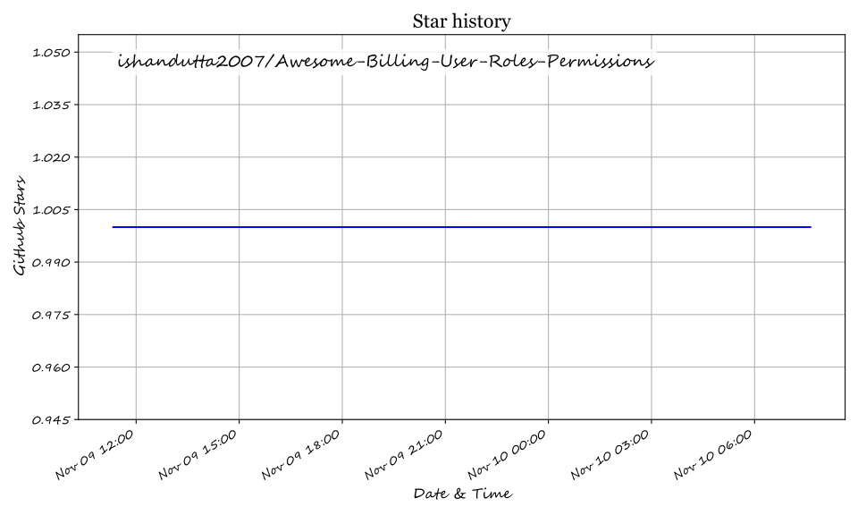

# Awesome-Billing-User-Roles-Permissions
# Awesome-Billing-User-Roles-Permissions

## Top Billing User Roles & Permissions Ecosystem

**Curated List of SaaS Products & Open-Source GitHub Projects**  
*Focused on User Provisioning, Role Assignment & Permission Delegation for Billing Systems*  
**Last updated: March 2026**

This repository tracks notable **SaaS platforms** and **open-source projects** for **Billing User Roles & Permissions**. These tools help organizations manage who can access billing systems, what actions they can perform, and how roles are assigned across teams—covering user lifecycle management, granular permission delegation, and least-privilege enforcement for finance, support, and administrative users.

**Examples** include Chargebee User Management, Okta User Management, Microsoft Entra User Management, Google Workspace Directory, JumpCloud, OneLogin, Ping Identity, CyberArk, Auth0, and AWS IAM (the category leaders).

**Open-source emphasis**: This section highlights every major active project for self-hosted identity and access management with native RBAC, user provisioning, and permission delegation—ideal for SaaS builders, platform engineers, and security teams building transparent, vendor-neutral billing access control.

Contributions welcome! Open an PR to add/update entries. Keep descriptions factual and link to official sites.

## Table of Contents
- [SaaS/Hosted Platforms](#saas-products)
- [Open-Source GitHub Projects](#open-source-github-projects)
- [How to Contribute](#how-to-contribute)
- [Disclaimer](#disclaimer)

## SaaS/Hosted Platforms

- **[Chargebee User Management](https://www.chargebee.com/docs/billing/2.0/site-configuration/account_settings)**  
  Billing platform with predefined roles (Tech Support, Analyst, Sales Agent, Customer Support, Sales Manager, Finance Executive, Developer, Owner) and support for custom roles via CSV configuration; users can hold multiple roles, with explicit deny taking precedence; separate TEST and LIVE site access requires independent invitations [citation:1][citation:12].

- **[Okta User Management](https://developer.okta.com/docs/api/openapi/okta-management/guides/roles)**  
  Identity platform with standard admin roles (ORG_ADMIN, USER_ADMIN, APP_ADMIN, HELP_DESK_ADMIN, READ_ONLY_ADMIN, etc.) and IAM-based standard roles with preset permission sets; custom roles allow granular permission assignment, with resource targeting for scoped access [citation:2].

- **[Microsoft Entra User Management](https://learn.microsoft.com/en-us/entra/)**  
  Cloud IAM with built-in roles including Global Administrator, User Administrator, Billing Administrator, and custom role definitions; role assignments bind principals to role definitions at tenant, administrative unit, or object scope; custom roles require Entra ID P1/P2 licensing [citation:3][citation:14].

- **[Google Workspace Directory](https://knowledge.workspace.google.com/admin/users/view-role-assignments-and-privileges)**  
  Admin console with role assignments at user and group level; administrators can view direct and indirect (group-inherited) roles, review granular privileges with organizational unit scope, and manage role assignments from both user and role-centric views [citation:15].

- **[JumpCloud](https://jumpcloud.com/support/vault-roles)**  
  Directory platform with Vault RBAC supporting three static roles (Admin, Guest, User) plus custom roles with hierarchical permissions; permissions are additive across multiple roles, with special per-user permission overrides for edge cases; default role auto-assigned via SCIM/SSO provisioning [citation:5].

- **[OneLogin](https://docs-be.oneidentity.com/bundle/onelogin_administration-portal/page/guides/administrationportal/roles.htm)**  
  Identity platform where roles are collections of applications; assigning a user to a role grants access to all included apps; mappings automate role assignment based on user attributes (e.g., department), with manual assignment available for exceptions .

- **[Ping Identity](https://docs.pingidentity.com/autonomous-identity/2022.11.12/admin-guide/chap-manage-identities.html)**  
  Identity platform with authorization roles assignable during user creation or via existing user editing; default roles have fixed permissions viewable but not editable; role members can be managed from both user detail and role member views [citation:7].

- **[CyberArk](https://docs.cyberark.com/)**  
  Privileged access management with built-in roles mapped to license types: Privilege Cloud Administrators, Auditors, Safe Managers, Users, External Vendors, Session Risk Managers, and Session Admin; role assignment determines both permissions and license consumption [citation:8].

- **[Auth0](https://auth0.com/docs/get-started/manage-dashboard-access/feature-access-by-role)**  
  Identity platform with Dashboard roles including Admin, Editor-Connections, Editor-Users, Editor-Organizations, Viewer-Users, and Viewer-Config Settings; each role grants scoped read/write access to specific Dashboard sections with least-privilege enforcement [citation:9].

- **[AWS IAM](https://docs.aws.amazon.com/IAM/latest/UserGuide/access_policies_manage-attach-detach.html)**  
  Identity and access management with users, groups, roles, and policies; managed policies, inline policies, and permissions boundaries control access; policies define allowed/denied actions, resources, and conditions for billing and cost management services [citation:10].

## Open-Source GitHub Projects

- **[Keycloak](https://github.com/keycloak/keycloak)**  
  Open-source identity and access management with RBAC, fine-grained admin permissions, realms, groups, and role mappings; supports user federation, identity brokering, and authorization services for billing application access control.

- **[Casdoor](https://github.com/casdoor/casdoor)**  
  Open-source IAM/SSO platform with web UI supporting OAuth 2.0, OIDC, SAML, CAS, LDAP, and RBAC; multi-tenancy via organizations with per-organization users, applications, and roles for billing system isolation.

- **[ZITADEL](https://github.com/zitadel/zitadel)**  
  Open-source identity platform built on event sourcing with OIDC, SAML, and RBAC; provides audit trails for compliance and multi-instance isolation for tenant-specific billing access management.

- **[Casbin](https://github.com/casbin/casbin)**  
  Open-source authorization library supporting ACL, RBAC, ABAC, and custom models across Go, Java, Node.js, Python, PHP, .NET, and Rust; middleware integrations for popular web frameworks enable embedded permission checks in billing APIs.

- **[WSO2 Identity Server](https://github.com/wso2/product-is)**  
  Open-source IAM solution with role-based access control, adaptive MFA, identity federation, and user management via OAuth2, OIDC, SAML, SCIM 2.0, and FIDO2; recognized as a Digital Public Good [citation:11].

- **[Permify](https://github.com/Permify/permify)**  
  Open-source authorization-as-a-service inspired by Google Zanzibar; supports RBAC, ReBAC, and ABAC with sub-10ms access checks and multi-tenant isolation for billing authorization logic.

- **[OPA (Open Policy Agent)](https://github.com/open-policy-agent/opa)**  
  Policy-as-code engine using Rego for fine-grained authorization decisions; supports audit logging and multi-dimensional access control for billing API permissions.

### Additional Strong Open-Source Options

- **[Ory Keto](https://github.com/ory/keto)** for Zanzibar-style relationship-based access control with REST API.
- **[OpenFGA](https://github.com/openfga/openfga)** for fine-grained authorization inspired by Google Zanzibar, with SDKs and a playground.
- **[Cerbos](https://github.com/cerbos/cerbos)** for policy-as-code authorization with YAML-based policies and language-agnostic SDKs.
- **[go-iam](https://github.com/melvinodsa/go-iam)** for lightweight multi-tenant IAM in Go with RBAC, custom roles, and OAuth provider integration.

**Frameworks for building custom systems**: Combine **Keycloak** or **ZITADEL** for identity and user management, **Casbin** or **OPA** for embedded authorization logic, and **Casdoor** for multi-tenant billing access control—integrated with billing platforms via SCIM for automated provisioning.

## How to Contribute

1. Fork the repo.
2. Add/edit entries in `README.md` (follow existing format).
3. Include: name, link, 1–2 sentence description, and whether it's SaaS or open-source.
4. Submit PR with a short explanation.

Star the repo if you find it useful!

## Disclaimer

- This is a **community-curated** list — not exhaustive and not an endorsement.
- Billing user management must enforce separation of duties (e.g., invoice creation vs. refund approval) and comply with financial controls (SOX, PCI DSS where applicable).
- Self-hosted open-source IAM solutions require proper role design, regular access reviews, and audit logging to prevent privilege creep.

---

**Made for SaaS finance engineers, platform security teams, identity architects, and developers building billing access control.**  
Let's make billing user permissions more open, granular, and auditable.

## ⭐ Star History

<a href="https://star-history.com/#ishandutta2007/Awesome-Billing-User-Roles-Permissions&Timeline" align="center">
  <picture>
    <source media="(prefers-color-scheme: dark)" srcset="assets/ishandutta2007_Awesome-Billing-User-Roles-Permissions_growth.svg">
    
  </picture>
</a>
